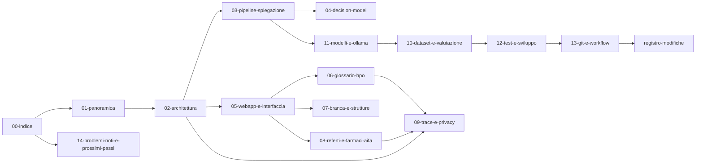

# Referto: documentazione di progetto

Punto di partenza per l'onboarding, per le persone e per Claude Code. Ogni nota
descrive un'area del codice e rimanda alle altre con `[[collegamenti]]`: aperta
come vault in Obsidian, la cartella `docs/` diventa un grafo navigabile (vedi
[[come-usare-questa-documentazione]]).

> **Regola:** ogni modifica al codice aggiorna la nota dell'area toccata e
> [[registro-modifiche]]. È scritto anche in `CLAUDE.md` alla radice del repo.

## Ordine di lettura consigliato

1. [[01-panoramica]]: cos'è Referto, l'hackathon, i vincoli del track Health.
2. [[02-architettura]]: moduli, flusso di una richiesta, dove vivono i dati.
3. [[03-pipeline-spiegazione]]: il cuore, dal testo del referto alla spiegazione.
4. [[05-webapp-e-interfaccia]]: rotte Flask, sezioni della UI, principi di semplicità.
5. Le funzioni costruite sopra la spiegazione:
   [[06-glossario-hpo]], [[07-branca-e-strutture]], [[08-referti-e-farmaci-aifa]].
6. [[09-trace-e-privacy]]: cosa viene salvato e dove.
7. [[11-modelli-e-ollama]] e [[10-dataset-e-valutazione]]: modelli, dataset, cluster.
8. [[12-test-e-sviluppo]] e [[13-git-e-workflow]]: come lavorare sul repo.
9. [[14-problemi-noti-e-prossimi-passi]]: cosa non funziona ancora.

## Mappa

Stessa struttura del grafo Obsidian, in forma leggibile da Claude Code.

## Mappa dei file del codice

| File | Ruolo | Nota |
|---|---|---|
| `spiega_referto.py` | Pipeline di spiegazione, prompt, validatori, CLI | [[03-pipeline-spiegazione]] |
| `decision_model.py` | Decide se saltare l'audit (Laya o BGE-M3) | [[04-decision-model]] |
| `web_app.py` | App Flask: rotte API e pagina | [[05-webapp-e-interfaccia]] |
| `templates/index.html`, `static/app.js`, `static/app.css` | Interfaccia | [[05-webapp-e-interfaccia]] |
| `glossario_medico.py`, `glossario/` | Glossario HPO | [[06-glossario-hpo]] |
| `strutture_sanitarie.py` | Branca del referto e mappa OpenStreetMap | [[07-branca-e-strutture]] |
| `archivio_referti.py` | Storico dei referti (sulle trace) | [[08-referti-e-farmaci-aifa]] |
| `farmaci_referti.py`, `farmaci/` | Farmaci dei referti e prontuario AIFA | [[08-referti-e-farmaci-aifa]] |
| `trace_store.py`, `performance_metrics.py` | Trace e metriche delle chiamate | [[09-trace-e-privacy]] |
| `benchmarking.py` | Benchmark A/B con e senza decision model | [[04-decision-model]] |
| `cluster_agent_task.py`, `submit_h100.sh`, `merge_datasets.py` | Esecuzione batch e dataset | [[10-dataset-e-valutazione]] |
| `test_app.py` | Test automatici | [[12-test-e-sviluppo]] |
| `check-usage-app/` | Dashboard dell'usage dell'API AMD | [[11-modelli-e-ollama]] |
