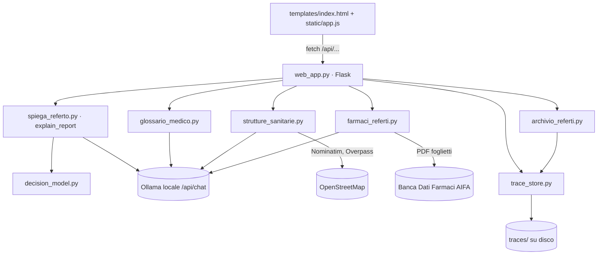

# Architettura

Torna a [[00-indice]] · Contesto in [[01-panoramica]].

## Componenti

Tutto è Python standard più Flask, pypdf, PyMuPDF e Pillow (`requirements.txt`).
Le chiamate ai modelli usano l'API nativa di Ollama (`/api/chat`, `/api/embed`),
non quella compatibile OpenAI: passare a vLLM o a un endpoint OpenAI richiede di
adattare `ollama_chat` e le chiamate dei moduli (vedi [[11-modelli-e-ollama]]).

## Flusso di un'analisi (testo, PDF o foto)

Rotte `POST /api/analyze/text|pdf|image` in `web_app.py`:

1. Si apre una trace (`TraceRecorder`) e si prende il lock del modello
   (`MODEL_LOCK`: una sola analisi alla volta).
2. **Lettura:** testo incollato, oppure testo estratto dal PDF (pypdf), oppure
   trascrizione delle immagini con il modello multimodale (per PDF scansionati e foto).
3. **Spiegazione:** `explain_report()`, vedi [[03-pipeline-spiegazione]] e [[04-decision-model]].
4. **Glossario:** `_glossary()` → `build_glossary()`, vedi [[06-glossario-hpo]].
5. **Branca:** `_branch()` → `classify_report()`, vedi [[07-branca-e-strutture]].
6. **Farmaci:** `_medications()` → `extract_medications()`, vedi [[08-referti-e-farmaci-aifa]].
7. Artefatti salvati nella trace (`glossary`, `branch`, `medications`), risposta
   JSON con `result`, `glossary`, `branch`, `medications`, `trace_id`.

I passi 4–6 non bloccano mai la spiegazione: se il modello non risponde, ognuno
ha una soluzione di riserva deterministica.

**Costo:** un'analisi fa almeno 4 chiamate al modello (spiegazione con audit,
glossario, branca, farmaci) più quelle di audit e riparazione. Su Mac con un
modello da 7B servono minuti; vedi [[14-problemi-noti-e-prossimi-passi]].

## Dove vivono i dati

| Percorso | Contenuto | In Git |
|---|---|---|
| `traces/` | Ogni esecuzione: testo del referto, prompt, risposte, artefatti | No |
| `risultati/`, `benchmarks/` | Output di dataset e benchmark | No |
| `glossario/hpo_glossario.json` | Glossario HPO (~19.000 termini) | Sì |
| `glossario/parole_salvate.json` | Spiegazioni semplici generate e parole incontrate | No |
| `farmaci/aifa_farmaci.json` | Prontuario AIFA (~12.600 farmaci) | Sì |
| `farmaci/normalizzazione.json` | Sali e alias dei nomi dei farmaci (app e [[15-servizio-farmaci]]) | Sì |
| `servizio-farmaci/data/atc.json` | Descrizioni della classificazione ATC | Sì |
| `farmaci_cache/` | PDF dei foglietti già aperti | No |
| `strutture_cache/` | Risposte di Nominatim e Overpass | No |
| `profilo/profilo.json` | Profilo del paziente (città) | No |
| `datasets/` | Dataset di referti per test e valutazione | Sì |

Dettagli in [[09-trace-e-privacy]].
